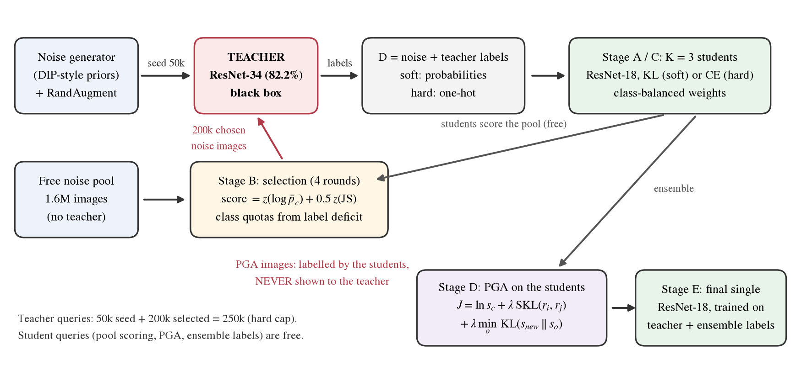
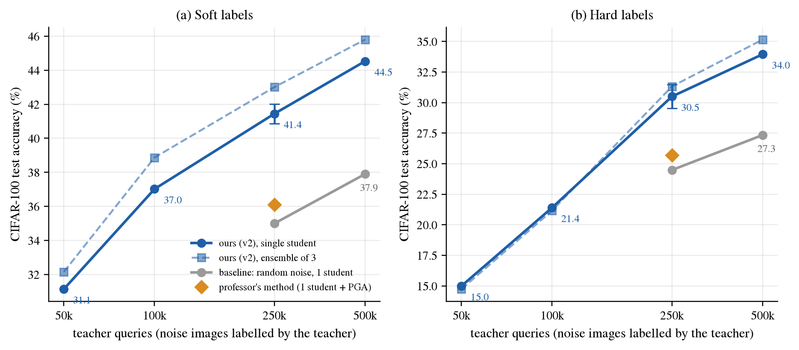
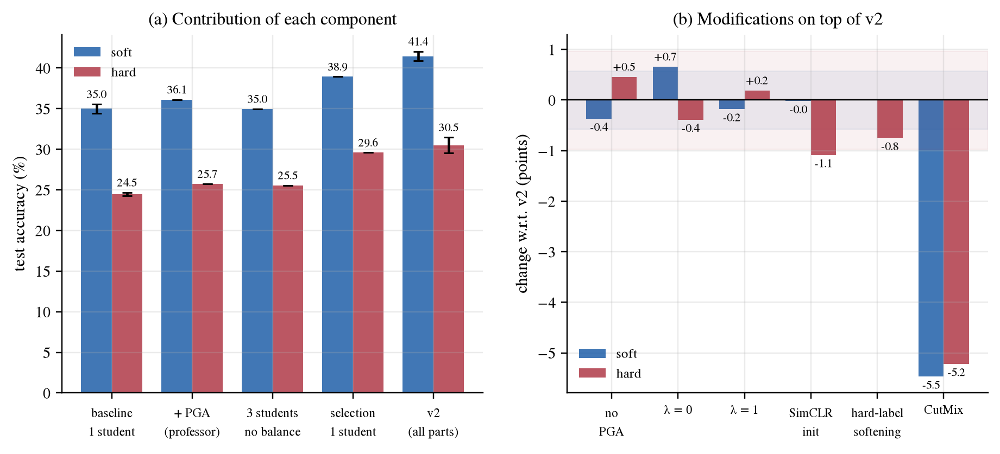
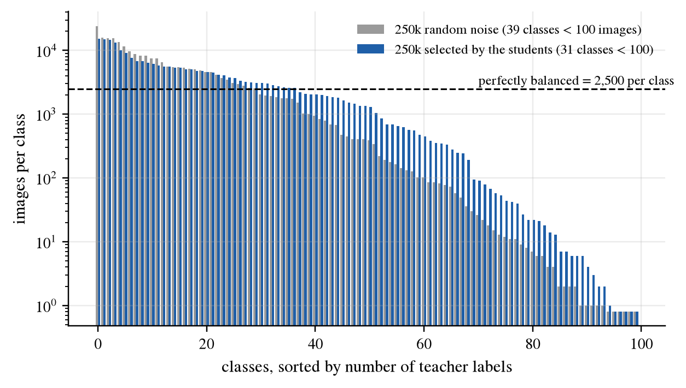
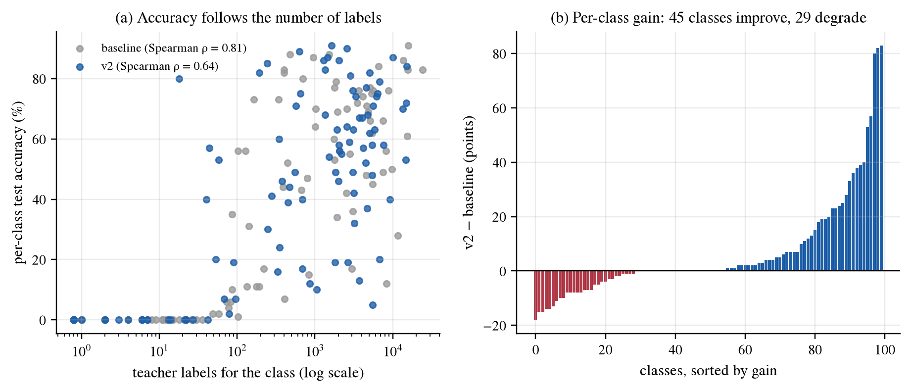
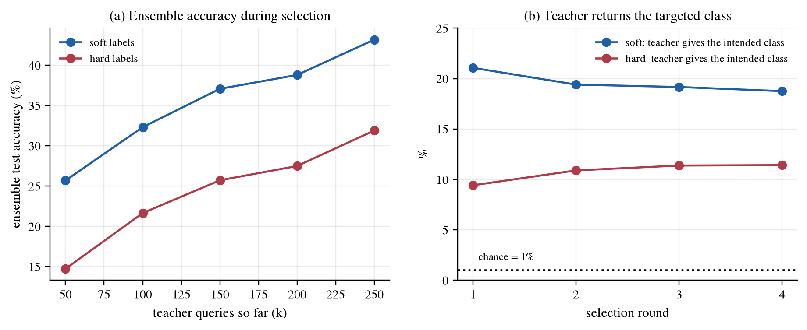

# Introduction

Machine-learning models are increasingly deployed behind application programming interfaces (APIs): a user submits an input and receives a prediction, but has no access to the model's parameters, gradients or training data. *Black-box knowledge distillation* (KD) asks how well a new model, the *student*, can be trained solely by querying such a *teacher*. The question matters from two complementary perspectives:

- **Model compression.** It enables compact models to be derived from proprietary ones when the original training data is private.
- **Security.** It is the mechanism behind *model-stealing* attacks, so the number of queries needed to replicate a model directly measures how much protection a query limit offers.

The most demanding variant is *data-free* distillation. Here no natural images are available, so the student must learn from synthetic inputs, and every teacher answer has a monetary or rate-limit cost. Most existing methods, such as DFME [3], IDEAL [6], DisGUIDE [7] and CaBaGE [10], train an image generator against the student (and sometimes the teacher) and consume between two and several tens of millions of queries. They also send the teacher images that were explicitly optimised for the attack.

This project follows a stricter protocol proposed by our supervisor:

1. The teacher is a black box.
2. No natural training data is used.
3. The teacher is only ever shown random noise.
4. At most 250K teacher queries are allowed.
5. All image optimisation (PGA) is performed on the student, with a diversity criterion defined in the student's softmax space.

Because the teacher never sees optimised images, all intelligence on the teacher side must lie in *which* noise images are queried.

**Contributions.**

- **A faithful implementation of the supervisor's method.** It covers the noise seed, teacher labelling, soft-label (KL) and hard-label (CE) distillation, and student-side PGA with a symmetric-KL diversity objective over the non-target softmax. The query budget is enforced in code.
- **Student-guided, class-balanced query selection.** A three-student ensemble scores free noise with a standardised combination of class confidence and Jensen–Shannon disagreement. The budget is allocated over four active-learning rounds with deficit-driven class quotas. At equal budget this improves accuracy by about 6 points for both label types.
- **A systematic empirical study.** It comprises 40 training runs: 3 seeds for the main configurations, a budget sweep from 50K to 500K queries, 9 ablations, per-class and information-theoretic analyses, and a direct visualisation of the effect of the diversity term.
- **A careful comparison with the literature,** together with a discussion of the limitations of noise-only distillation.

# Related Work

**Knowledge distillation and data-free KD.** Hinton et al. [1] introduced distillation with temperature-softened teacher probabilities. Data-free methods synthesise their own training inputs: DAFL [21] trains a generator whose outputs the teacher classifies confidently, DeepInversion [16] matches the batch-normalisation statistics stored in the teacher, and CMI [22] adds a contrastive term to diversify the synthesised images. These methods require white-box access to gradients and internal statistics and are therefore inapplicable here. Two of their ideas nonetheless motivate the present design: optimising images towards a class, and explicitly enforcing diversity among synthetic samples.

**Black-box model stealing with soft labels.** Knockoff Nets [23] query the teacher with natural images from a surrogate dataset, which requires real data. DFME [3] and MAZE [4] train a generator to maximise the teacher–student discrepancy and estimate the teacher's gradient by zeroth-order finite differences. They require 20–30M queries even on CIFAR-10. CaBaGE [10] combines a generator ensemble with class-balanced, difficulty-weighted replay and selective querying. It recovers 75.96% of a 77.52% teacher on CIFAR-100 with millions of queries.

**Black-box model stealing with hard labels.** Hard labels convey at most $\log_2 100 \approx 6.6$ bits per query, which makes the problem substantially harder:

- ZSDB3KD [2] reconstructs soft labels from distances to the teacher's decision boundaries, at a large query cost.
- DFMS-HL [5] trains a generator with a class-diversity loss (about 10M queries).
- IDEAL [6] trains the generator only against the student and labels each synthetic image once, reaching 36.96% on CIFAR-100 with 2M queries.
- DisGUIDE [7] uses two students and seeks inputs on which they disagree. Dual-student variants [8] report failures on CIFAR-100 caused by class imbalance.
- MGCT [24] and stabilised DFME [25] add multiple generators and class-balance constraints.
- DFHL-RS [9] extracts accuracy and robustness from a robust teacher with tens of millions of queries.
- Attacks based on diffusion models [12] reach about 57–60% with 150K queries, but their inputs carry prior knowledge of natural objects.

**Image priors and noise.** Closest to our setting is DIP-KD [11]. It queries a hard-label teacher only with fixed synthetic priors (hierarchical noise, non-linear warps and semantic CutMix) and adds contrastive learning and a "primer" student. It reports 52.85% on CIFAR-100 with 100K images. Baradad et al. [15] showed that procedural noise with natural-image statistics can pre-train useful representations, and that the diversity of the noise is critical.

**Query selection and class imbalance.** ActiveThief [13] selects pool samples for labelling by student uncertainty. A follow-up [14] identifies the resulting class imbalance as a major failure mode and corrects it by re-weighting and rare-class sampling. Our stage-B selection follows this line, but operates on a pool of *free noise* rather than natural images.

**Projected gradient ascent.** ZOPGA-KD [17] synthesises class-targeted images by PGA on the *teacher*, using zeroth-order gradient estimates that each cost many queries. The supervisor's variant moves PGA to the *student*, whose gradients are exact and free, and adds a diversity term defined in the student's softmax space.

Table: Taxonomy of related black-box distillation methods.

| Method | Teacher output | Source of query images | Teacher sees optimised images | CIFAR-100 queries |
|:---|:---:|:---:|:---:|:---:|
| Knockoff Nets [23] | soft | natural surrogate data | no | — |
| DFME / MAZE [3, 4] | soft | generator vs. teacher & student | yes | tens of millions |
| CaBaGE [10] | soft / hard | generator ensemble + replay | yes | millions |
| ZSDB3KD [2] | hard | boundary search | yes | very large |
| IDEAL [6] | hard | generator vs. student | yes | 2M |
| DisGUIDE [7] | hard | generator, two students | yes | ≈10M |
| DIP-KD [11] | hard | fixed image priors | no | 100K |
| **Ours** | **soft / hard** | **random noise, student-selected** | **no** | **50K–500K** |

# Problem Setting

## Threat model and constraints

The teacher $T$ is a fixed CIFAR-100 classifier exposed as an oracle. A query on an image $x$ returns either the full probability vector or its arg-max:

::: {.eq n="1"}
$$ \text{soft: } p_T(x)\in\Delta^{K-1}, \qquad \text{hard: } y_T(x)=\arg\max_{k}\, p_T(x)_k , $$
:::

with $K=100$ classes. Five rules define the setting:

- **(R1) Black box.** Only input–output access to $T$.
- **(R2) No data.** No natural image is used for training. The CIFAR-100 test set is used exclusively for evaluation.
- **(R3) Noise only.** The teacher is only shown random-noise images.
- **(R4) Budget.** At most $B$ = 250,000 teacher queries.
- **(R5) PGA on the student.** Optimised (PGA) images are generated on the student and are never sent to the teacher.

Forward and backward passes through our own students are unrestricted.

## Objective

We select a query set $Q=\{x_1,\dots,x_N\}$ of noise images with $N\le B$ and a set $G$ of free synthetic images labelled by our own students, and train the student $S_\theta$ by

::: {.eq n="2"}
$$ \min_\theta\; \sum_{x\in Q} w(x)\,\ell\big(S_\theta(x),\,T(x)\big)\;+\;\beta\sum_{x\in G}\ell\big(S_\theta(x),\,\hat p(x)\big), $$
:::

where $\hat p$ denotes ensemble pseudo-labels, $w(x)$ a class-balancing weight and $\beta$ the weight of the free data. The distillation loss is

::: {.eq n="3"}
$$ \ell_{\text{soft}}=\tau^2\,\mathrm{KL}\!\big(\mathrm{softmax}(z_T/\tau)\,\big\|\,\mathrm{softmax}(z_S/\tau)\big),\qquad \ell_{\text{hard}}=\mathrm{CE}\big(S_\theta(x),\,y_T(x)\big), $$
:::

with temperature $\tau=4$. The two design questions are therefore *which noise images enter $Q$* (the teacher side, constrained by R3–R4) and *which free images enter $G$* (the student side, unconstrained). Table 2 summarises the notation.

Table: Notation.

| Symbol | Meaning |
|:---|:---|
| $T$, $S$ | teacher (black box), student (ResNet-18) |
| $p_T(x)$, $y_T(x)$ | teacher probabilities (soft) / class (hard) |
| $s(x)$ | student softmax; $s_c(x)$ its probability for class $c$ |
| $r(x)$ | student softmax renormalised over the 99 non-target classes |
| $\bar p(x)$, $p_k(x)$ | ensemble-mean prediction, prediction of student $k$ |
| $B$, $Q$, $G$ | teacher budget, teacher-labelled set, free student-labelled set |
| $\lambda_{\text{intra}}$, $\lambda_{\text{old}}$ | weights of the two diversity terms in PGA |
| $\tau_c$ | target confidence of PGA (0.8 or 0.9) |
| SKL | symmetric KL divergence, $\tfrac12[\mathrm{KL}(a\|b)+\mathrm{KL}(b\|a)]$ |

# Method

## Overview

The full pipeline (v2) is depicted in Fig. 1 and listed in Algorithm 1. It proceeds in five stages:

- **A (seed).** A seed of random noise is labelled by the teacher and three students are trained on it.
- **B (selection).** The students select the remaining queries from a free noise pool in four rounds.
- **C (students).** Three fresh students are trained on all teacher-labelled data.
- **D (PGA).** PGA on the student ensemble produces free, diverse, class-targeted images.
- **E (consolidation).** A single final student is consolidated from the teacher labels and the ensemble labels.

Only stages A and B touch the teacher.

{width=100%}

```{=html}
<div class="algorithm">
<div class="alg-title"><b>Algorithm 1:</b> Student-guided black-box distillation from noise (v2)</div>
<div class="alg-io"><b>Input:</b> teacher oracle <i>T</i>, budget <i>B</i> = 250K, seed size 50K, rounds <i>R</i> = 4, students <i>K</i> = 3<br><b>Output:</b> student ResNet-18 <i>S</i><sub>final</sub></div>
<ol>
<li><i>X</i><sub>0</sub> ← 50K noise images + RandAugment; &nbsp; <i>D</i> ← {(<i>x</i>, <i>T</i>(<i>x</i>)) : <i>x</i> ∈ <i>X</i><sub>0</sub>} <span class="alg-c">▷ 50K teacher queries</span></li>
<li>Train students <i>S</i><sub>1..K</sub> on <i>D</i> (Eq. 3, class-balanced weights Eq. 4)</li>
<li><b>for</b> <i>r</i> = 1 … <i>R</i> <b>do</b></li>
<li class="ind">Draw a pool <i>P</i> of 400K free noise images; score every (<i>x</i>, <i>c</i>) with Eq. 8 <span class="alg-c">▷ free</span></li>
<li class="ind">Compute class quotas from the label deficit (Eq. 9); pick the top-scoring images per class</li>
<li class="ind"><i>D</i> ← <i>D</i> ∪ {(<i>x</i>, <i>T</i>(<i>x</i>))} for the 50K chosen images <span class="alg-c">▷ 50K teacher queries</span></li>
<li class="ind">Fine-tune <i>S</i><sub>1..K</sub> on <i>D</i> for 10 epochs</li>
<li><b>end for</b></li>
<li>Train fresh students <i>S</i><sub>1..K</sub> on <i>D</i> (|<i>D</i>| = 250K) with class-balanced weights</li>
<li>Generate <i>G</i><sub>PGA</sub> by PGA on the ensemble (Eqs. 5–7); keep if all agree, conf. ≥ 0.8 <span class="alg-c">▷ never sent to <i>T</i></span></li>
<li>Label <i>G</i><sub>PGA</sub> and 250K extra noise images with the ensemble <span class="alg-c">▷ free</span></li>
<li><i>S</i><sub>final</sub> ← fine-tune the best student on <i>D</i> ∪ <i>G</i> (Eq. 2)</li>
</ol>
</div>
```

```{=latex}
\begin{algorithm}[t]
\caption{Student-guided black-box distillation from noise (v2)}
\begin{algorithmic}[1]
\Require teacher oracle $T$, budget $B{=}250$K, seed size 50K, rounds $R{=}4$, students $K{=}3$
\Ensure student ResNet-18 $S_{\text{final}}$
\State $X_0\gets$ 50K noise images + RandAugment;\; $D\gets\{(x,T(x)) : x\in X_0\}$ \Comment{50K teacher queries}
\State Train students $S_{1..K}$ on $D$ (Eq.~\ref{eq:3}, weights Eq.~\ref{eq:4})
\For{$r=1,\dots,R$}
  \State Draw a pool $P$ of 400K free noise images; score all $(x,c)$ with Eq.~\ref{eq:8} \Comment{free}
  \State Compute class quotas from the label deficit (Eq.~\ref{eq:9}); take top-scoring images per class
  \State $D\gets D\cup\{(x,T(x))\}$ for the 50K chosen images \Comment{50K teacher queries}
  \State Fine-tune $S_{1..K}$ on $D$ for 10 epochs
\EndFor
\State Train fresh students $S_{1..K}$ on $D$ ($|D|=250$K) with class-balanced weights
\State $G_{\text{PGA}}\gets$ PGA on the ensemble (Eqs.~\ref{eq:5}--\ref{eq:7}); keep if all agree and conf.\ $\ge 0.8$ \Comment{never sent to $T$}
\State Label $G_{\text{PGA}}$ and 250K extra noise images with the ensemble \Comment{free}
\State $S_{\text{final}}\gets$ fine-tune the best student on $D\cup G$ (Eq.~\ref{eq:2})
\end{algorithmic}
\end{algorithm}
```

## Noise priors

Following the supervisor's whiteboard design, the first seed sets consisted of Gaussian, uniform, pink and Perlin noise. In a 10K-query pilot with soft labels, a student trained on these reached only 5.1%, a mixture reached 8.6%, and DIP-style priors [11] reached 11.5%. All reported experiments therefore use DIP-style priors. These are hierarchical multi-scale noise with random rotations and elastic warps, two of which (or one and a plain colour) are blended through a smooth random blob mask, with per-image random colour and contrast. Every image is further transformed by RandAugment [20] with two operations of magnitude 9. Generation and augmentation run on the GPU. Representative samples are shown in Fig. 2.

## Distillation with class-balanced weighting

Students are CIFAR-style ResNet-18 networks (3×3 stem, no max-pooling). They are trained with SGD and Nesterov momentum (0.9), learning rate 0.1, weight decay $5\cdot10^{-4}$, batch size 128, one warm-up epoch followed by cosine decay, and random-crop and flip augmentation.

The teacher's answers on noise are extremely imbalanced. On 250K random noise images, the ten most frequent classes receive 52.6% of all labels, 39 classes receive fewer than 100 images, and 6 classes never occur (Section 6.4). Each teacher-labelled image is therefore weighted by

::: {.eq n="4"}
$$ w(x)=\operatorname{clip}\!\Big(\big(\bar n / n_{y(x)}\big)^{1/2},\;0.25,\;4\Big), $$
:::

where $n_y$ is the number of images labelled $y$ and $\bar n$ the mean count. The weights are renormalised to mean one.

{width=100%}

## Student-side PGA with softmax-space diversity

Given target classes $c_i$ for a batch of images, PGA *maximises* the following objective over the pixels while the student is frozen:

::: {.eq n="5"}
$$ \begin{aligned} J(x_i)&=\ln s_{c_i}(x_i)\;+\;\lambda_{\text{intra}}\,\frac{1}{|P_i|}\sum_{j\in P_i}\mathrm{SKL}\big(r(x_i),r(x_j)\big)\\ &\quad+\;\lambda_{\text{old}}\min_{o\in D,\;y_o=c_i}\mathrm{KL}\big(s(x_i)\,\|\,s(x_o)\big), \end{aligned} $$
:::

where $P_i$ is the set of other images in the batch with the same target class, and

::: {.eq n="6"}
$$ r(x)_k=\frac{s_k(x)}{1-s_{c}(x)}\quad (k\neq c) $$
:::

is the student's distribution over the 99 *non-target* classes. The three terms have distinct roles:

- **The first term** drives the image towards class $c_i$.
- **The second term** is the supervisor's diversity criterion: two images $i$ and $j$ of the same class must have different softmax outputs.
- **The third term** pushes new images away from the closest existing data point of that class.

The diversity is measured on $r$ rather than $s$ deliberately. All images of a class end with $s_c\approx\tau_c$, so their full softmax vectors are nearly identical. The non-target distribution, in contrast, encodes *what else an image resembles*: one "orchid" image may lean towards "tulip" and another towards "butterfly". Each KL term is capped at 5, so that diversity cannot override class attainment, and $\lambda_{\text{intra}}=\lambda_{\text{old}}=0.1$. The pixels are updated by normalised momentum ascent with projection onto the valid image range:

::: {.eq n="7"}
$$ g=\nabla_x J,\qquad m\leftarrow 0.9\,m+0.1\,g,\qquad x\leftarrow\Pi_{[0,1]}\Big(x+\alpha_t\,\frac{m}{\|m\|_2}\Big), $$
:::

where:

- the step size $\alpha_t$ decays from 0.5 to 0.1 over 300 steps (cosine schedule);
- the gradient is restricted to a low-resolution subspace (8×8, then 16×16 once the confidence exceeds 0.5) to avoid high-frequency artefacts;
- random shifts and flips are applied at every step;
- an image stops once $s_c\ge\tau_c$, with $\tau_c\in\{0.8,0.9\}$;
- images still below 0.3 confidence after 150 steps restart from fresh noise.

PGA is applied to the three-student ensemble with 200 targets per class (20K in total). An image is retained only if *all* students predict its target class and the ensemble confidence is at least 0.8. Retained images are labelled with the ensemble's probabilities and are never shown to the teacher.

## Student-guided query selection

Spending the budget on random noise wastes most queries on a few dominant classes. Instead, after a 50K random seed (stage A), the remaining 200K queries are spent in four rounds of 50K. In each round the students score a fresh pool of 400K free noise images. For image $x$ and class $c$ the score is

::: {.eq n="8"}
$$ \text{score}_c(x)=z\big(\log\overline{p}_c(x)\big)+0.5\,z\big(\mathrm{JS}(x)\big),\qquad \mathrm{JS}(x)=\frac1K\sum_{k=1}^{K}\mathrm{KL}\big(p_k(x)\,\|\,\overline{p}(x)\big), $$
:::

where JS is the generalised Jensen–Shannon disagreement of the $K=3$ students and $z(\cdot)$ standardises a score over the pool, so that both terms contribute on the same scale. Each class $c$ receives a quota

::: {.eq n="9"}
$$ q_c=n_r\Big(\frac{0.5}{100}+0.5\,\frac{\delta_c}{\sum_{c'}\delta_{c'}}\Big),\qquad \delta_c=\max\big(0,\;\bar n_{\text{target}}-n_c\big), $$
:::

where $n_r$ is the round size and $\delta_c$ is the label deficit of class $c$ with respect to a perfectly balanced set. The classes with the fewest labels select first, each taking its highest-scoring unclaimed images. After each round the students are fine-tuned for 10 epochs, so that the next round is chosen by better students (active learning).

## Query accounting

Table 3 lists the cost of every stage. The oracle counts every query and rejects any beyond the budget; for all main runs exactly 250,000 teacher queries are issued, all on noise images.

Table: Teacher and student queries per stage (one v2 run). Student passes are free under rule R4.

| Stage | Teacher queries | Student forward passes | Images involved |
|:---|:---:|:---:|:---|
| A — random seed | 50,000 | — | 50K noise images |
| B — selection (4 rounds) | 200,000 | 4.8M | 1.6M pool → 200K chosen |
| C — train students | 0 | — | 250K teacher-labelled |
| D — PGA | 0 | 6.0M | 20K targets → ≈11K kept |
| E — consolidation | 0 | 0.75M | 250K extra noise |
| **Total** | **250,000** | **≈11.5M** | |

# Experimental Setup

**Teacher.** The teacher is a CIFAR-style ResNet-34 trained for 200 epochs on 45,000 training images with SGD (learning rate 0.1, cosine decay, weight decay $5\cdot10^{-4}$) and CutMix (probability 0.5). The remaining 5,000 training images serve as a validation set. To avoid any test-set selection bias, the checkpoint was chosen on validation (epoch 197: 82.50% validation, 82.18% test). After training, the teacher is accessed exclusively through the query oracle.

**Configurations.** Table 4 lists the evaluated configurations. All ablations of stages C–E reuse the teacher-labelled data of v2 (seed 1), so they consume no additional queries and differ from v2 only in the component under study.

Table: Evaluated configurations (each with soft and hard labels).

| Name | Description |
|:---|:---|
| Baseline | 1 student trained on 250K random noise images; no selection, no PGA |
| Professor | Baseline + student-side PGA with diversity (Section 4.4) |
| v2 (ours) | Full pipeline of Section 4 (Algorithm 1) |
| v2 at 50K / 100K / 500K | Same pipeline at other budgets; the seed is 20% of the budget |
| Baseline-500K | Baseline with a 500K budget |
| Ablations | Remove or modify one component of v2 (Table 7) |

**Metrics and protocol.** We report top-1 accuracy on the 10,000 CIFAR-100 test images. Top-5 accuracy and teacher agreement are given in Appendix D. The main configurations are run with three seeds (1, 2, 3) and reported as mean ± sample standard deviation; ablations use a single seed.

**Compute.** All experiments ran on a single NVIDIA RTX 4000 Ada GPU (20 GB). A v2 run takes about six hours when two runs share the GPU. The complete study comprises 40 runs and about 75 hours of wall-clock time on this GPU, with two or three runs sharing it.

# Results

## Main results

Table: CIFAR-100 test accuracy (%) with 250K teacher queries. Mean ± std over three seeds (baseline: two seeds; professor: one run). Teacher: 82.18%.

| Method | Soft labels | Hard labels |
|:---|:---:|:---:|
| Baseline (random noise, 1 student) | 35.0 ± 0.6 | 24.5 ± 0.2 |
| Professor (+ student-side PGA with diversity) | 36.1 | 25.7 |
| **v2 — final single student** | **41.4 ± 0.6** | **30.5 ± 1.0** |
| **v2 — ensemble of three students** | **43.0 ± 0.2** | **31.3 ± 0.6** |
| Teacher (upper bound) | 82.2 | 82.2 |

Table 5 summarises the main results. At the same budget, the proposed pipeline improves the single student by **+6.4 points** with soft labels and **+6.0 points** with hard labels. This is an order of magnitude larger than the seed-to-seed standard deviation. The supervisor's PGA refinement alone improves the baseline by +1.1 (soft) and +1.2 (hard) points relative to the two-seed baseline mean. The ensemble of three students is consistently 1–1.5 points more accurate than the consolidated single student, and the top-5 accuracy of the final soft-label student is 64.0%.

## Accuracy as a function of the query budget

Fig. 3 and Table 6 support two conclusions:

1. **Selecting which noise the teacher labels is worth more than doubling the budget.** With 250K queries v2 exceeds the 500K baseline: 41.4 vs. 37.9 with soft labels and 30.5 vs. 27.3 with hard labels.
2. **The curve has not saturated.** Doubling the budget from 250K to 500K still adds about three points, so the method remains limited by the amount of information obtained from the teacher.

Hard labels are disproportionately affected at small budgets: with 50K queries they reach only half the soft-label accuracy, since a class index carries far less information than a probability vector.

{width=90%}

Table: Budget sweep: final single student (ensemble in parentheses), test accuracy in %.

| Teacher queries | v2, soft | v2, hard | Baseline, soft | Baseline, hard |
|:---|:---:|:---:|:---:|:---:|
| 50K | 31.1 (32.2) | 15.0 (14.7) | — | — |
| 100K | 37.0 (38.9) | 21.4 (21.2) | — | — |
| 250K | 41.4 (43.0) | 30.5 (31.3) | 35.0 | 24.5 |
| 500K | **44.5 (45.8)** | **34.0 (35.2)** | 37.9 | 27.3 |

## Ablation study

Fig. 4 and Table 7 isolate the contribution of each component.

**Selection is the decisive component.** Three students trained on random noise without balancing are no better than a single student (34.96% vs. 35.0%). Balanced selection with a single student already yields +3.9 points, and three disagreeing students add another 1.5–3 points.

**PGA and diversity have no measurable effect on top of selection.** Removing PGA, removing the diversity term, increasing it tenfold, or generating five times as many PGA images changes accuracy by at most 0.7 points, within about one seed standard deviation. In the single-student setting, by contrast, PGA helps (Table 5). Section 6.5 analyses this discrepancy.

**CutMix is harmful (−5 points).** For natural images, CutMix rests on the assumption that a mixture of two images has the corresponding mixture of labels. On noise, the teacher's decision depends on fine-grained texture statistics, and pasting a patch of one image into another changes the prediction in ways that the interpolated label does not describe.

**Two components of DIP-KD did not transfer.** Neither contrastive pre-training on noise nor softening the hard labels with the ensemble (DIP-KD's "primer" idea) improved our pipeline.

A final configuration (v3) combines every modification that improved on v2 by more than 0.3 points. None qualified, so v3 reduces to a re-run of v2 (40.8% soft, 30.4% hard), consistent with the seed variance.

{width=92%}

Table: Ablations at 250K queries (final single student, %). Δ is relative to v2 seed 1 (42.03 soft / 31.04 hard).

| Variant | Soft | Δ | Hard | Δ |
|:---|:---:|:---:|:---:|:---:|
| 3 students, random 250K, no balancing | 34.96 | −7.1 | 25.55 | −5.5 |
| Balanced selection, 1 student | 38.93 | −3.1 | 29.58 | −1.5 |
| v2 without PGA | 41.66 | −0.4 | 31.50 | +0.5 |
| v2, PGA with λ = 0 (no diversity) | 42.69 | +0.7 | 30.65 | −0.4 |
| v2, PGA with λ = 1.0 (10× diversity) | 41.85 | −0.2 | 31.23 | +0.2 |
| v2, 5× more PGA images (100K) | 42.63 | +0.6 | — | — |
| v2 + contrastive (SimCLR) pre-training on noise | 42.01 | 0.0 | 29.95 | −1.1 |
| v2 + hard labels softened by the ensemble | — | — | 30.29 | −0.8 |
| v2 + CutMix | 36.56 | **−5.5** | 25.82 | **−5.2** |

## Why selection works

**The teacher maps most noise to a few classes.** Fig. 5 reveals the central difficulty of noise-only distillation, and selection mitigates it substantially (Table 8). The entropy of the teacher's label distribution bounds the information that a hard label can convey about the class. It rises from 5.11 to 5.54 bits per query (the maximum is $\log_2 100=6.64$), which corresponds to an increase in the effective number of covered classes from 34.6 to 46.7.

Table: Statistics of the teacher-labelled set (250K queries, soft-label runs).

| | Random noise | Student-selected |
|:---|:---:|:---:|
| Share of the ten most frequent classes | 52.6% | 42.0% |
| Classes with fewer than 100 images | 39 | 31 |
| Classes never labelled | 6 | 5 |
| Entropy of the label distribution | 5.11 bits | 5.54 bits |
| Effective number of classes ($2^{H}$) | 34.6 | 46.7 |
| Classes with 0% test accuracy | 32 | 22 |

{width=74%}

**Per-class accuracy is governed by label coverage.** Fig. 6(a) shows that a class is learned only if the teacher labelled enough noise images with it: the Spearman correlation between label count and accuracy is 0.81 for the baseline. Selection reduces the number of classes with 0% test accuracy from 32 to 22, and the number below 10% from 39 to 26. Overall, 45 classes improve and 29 degrade (Fig. 6(b)). The strongest gains, of up to 80 points, occur for classes that the baseline almost never saw.

{width=92%}

**Each round produces better selectors.** The soft-label ensemble improves after every round: 25.7 → 32.3 → 37.1 → 38.8% after rounds 1–3, and 43.2% after the stage-C retraining (Fig. 7(a)). The teacher returns the class targeted by the students for about 19–21% of the selected images with soft labels and 9–11% with hard labels, against 1% by chance (Fig. 7(b)). The selected images have about twice the student disagreement of the pool (0.135 vs. 0.066 in round 1). The budget is thus spent on rare classes and on images where the students are uncertain, which are exactly the queries whose answers are most informative. This is the principle of DisGUIDE [7] and CaBaGE [10], applied here to *choosing among noise* rather than to *training a generator against the teacher*.

{width=86%}

## Effect of the diversity term

Each PGA image may be viewed as a *point* in the student's probability space. The intra-class term of Eq. 5 increases $\mathrm{SKL}(r_i,r_j)$ and thereby pushes points of the same class apart. The second term pushes each point away from its nearest existing neighbour of the same class.

**The mechanism works as intended.** The mean pairwise symmetric KL between same-class images grows almost fivefold, from 0.75 to 3.47 (Table 9). Without diversity, the samples of a class form a single tight cluster. With λ = 1 they spread along several directions, each pointing towards a different neighbouring class (Fig. 8).

**Diversity comes at a cost.** Strongly diversified images reach the target confidence far less often (13.5% vs. 46%), so only a third as many are retained.

**It does not improve accuracy.** The PGA images carry no new information about the teacher, because they are labelled by the students themselves. Making them more diverse cannot correct the students' own errors, so they act only as a regulariser. This regularisation is useful for a weak single student trained on random noise (+1.1 to +1.2 points), but is redundant for an ensemble that was already trained on well-selected teacher labels.

**Label reliability of PGA images.** For analysis only, after all experiments we evaluated the teacher on the retained PGA images; these answers never influenced training or selection. The teacher agrees with the students' labels for 90.5% of the soft-label images but only 56.2% of the hard-label images. Students trained on one-hot targets are over-confident on synthetic inputs, which makes the agreement-and-confidence filter less reliable in the hard-label setting.

{width=80%}

Table: Effect of the diversity weight λ (soft labels; PGA statistics over all classes).

| | λ = 0 | λ = 0.1 (v2) | λ = 1.0 |
|:---|:---:|:---:|:---:|
| Mean pairwise SKL between same-class images | 0.75 | 1.15 | **3.47** |
| PGA images retained (of 20K) | 10,906 | 10,778 | 3,289 |
| Images reaching the target confidence | 47.5% | 46.2% | 13.5% |
| Teacher agrees with retained labels (diagnostic) | 91.4% | 90.5% | 86.9% |
| Final student accuracy | 42.69 | 42.03 | 41.85 |

## Comparison with prior work

Table: Comparison with published CIFAR-100 results at their reported query budgets. "≈" marks approximate values or values from a secondary source; the teachers differ between rows.

| Method | Labels | Teacher queries | Teacher | Student | Student / teacher |
|:---|:---:|:---:|:---:|:---:|:---:|
| ZSDB3KD [2] (as reported in [6]) | hard | 2M | 89.45% | 17.51% | 0.20 |
| DFME [3] (as reported in [6]) | hard | 2M | 89.45% | 20.01% | 0.22 |
| IDEAL [6] | hard | 2M | 89.45% | 36.96% | 0.41 |
| DisGUIDE [7] | hard | ≈10M | — | ≈50% | — |
| DFHL-RS [9] (robust teacher) | hard | ≈77M | 56.76% | 51.94% | 0.92 |
| CaBaGE [10] | soft | millions | 77.52% | 75.96% | 0.98 |
| Diffusion attack [12] | hard | 150K | — | ≈57–60% | — |
| IDEAL (as reported in [11]) | hard | 100K | 78.36% | 33.64% | 0.43 |
| DFHL-RS (as reported in [11]) | hard | 100K | 78.36% | 51.97% | 0.66 |
| DIP-KD [11] | hard | 100K | 78.36% | 52.85% | 0.67 |
| **Ours (v2)** | **hard** | **100K** | **82.18%** | **21.4%** | **0.26** |
| **Ours (v2)** | **hard** | **250K** | **82.18%** | **30.5%** | **0.37** |
| **Ours (v2)** | **hard** | **500K** | **82.18%** | **34.0%** | **0.41** |
| **Ours (v2)** | **soft** | **250K** | **82.18%** | **41.4%** | **0.50** |

Table 10 places our results in context.

**Query efficiency against generator-based methods.** Relative to methods that train generators with millions of queries, our approach is query-efficient. With 4× fewer queries than IDEAL (500K vs. 2M), it recovers the same fraction of the teacher's accuracy (0.41). With 8× fewer queries it clearly exceeds ZSDB3KD and DFME evaluated at 2M. This is despite a stricter protocol: every generator-based method sends the teacher images optimised for the attack, whereas our teacher only sees random noise. Because our queries are plain noise, they reveal nothing about which classes the attacker is interested in, although noise itself is easily flagged by an out-of-distribution detector.

**The gap to fixed-prior methods.** At an equal budget of 100K hard-label queries, DIP-KD reports 52.85% against our 21.4%. Two of DIP-KD's three components (contrastive learning and soft-label priming) did not help in our pipeline (Table 7). This suggests that its advantage stems mainly from its image priors, semantic CutMix of structured patterns, which raise the information content of each query. The teachers and protocols also differ: DIP-KD's teacher is weaker (78.36%), and its synthetic set may be augmented differently.

**Soft-label methods.** With soft labels, CaBaGE recovers 98% of its teacher, but it uses millions of queries and generators trained against the teacher.

# Discussion

**Why noise-only distillation plateaus.** Our results consistently indicate that the bottleneck lies on the teacher side. Every intervention that increases the information obtained from the teacher (class-balanced selection, student disagreement, a larger budget) improves accuracy. Every intervention that only reshapes student-side data (PGA diversity, more PGA images, CutMix, contrastive pre-training) does not. Two effects drive this:

- The teacher assigns random noise to a small number of classes (effective number 34.6 of 100).
- A class is only learned if it receives enough labels: per-class accuracy correlates with label count at ρ = 0.81.

Consequently, roughly a fifth of the classes remain unlearned even after selection.

**Limitations.**

- *Absolute accuracy.* It remains far below the teacher: about 50% (soft) and 37% (hard) of the teacher's accuracy at 250K queries. No published method approaches the teacher from pure noise at this budget.
- *Statistical power.* Most ablations use a single seed, and their effects, apart from selection and CutMix, are within one seed standard deviation. They should be read as "no measurable effect" rather than as evidence of harm or benefit.
- *Diagnostic evaluation.* The label-quality analysis evaluated the teacher on PGA images after training. It never influenced any model, but it would be unavailable in a real deployment.
- *Final consolidation.* Stage E does not improve on the best stage-C student; the ensemble remains the most accurate model.

**An instructive exception.** In an exploratory run that violated rule R3 and is excluded from all reported results, sending PGA images to the teacher reached 36.8% with soft labels and only 150K queries. Teacher-labelled, class-targeted images are therefore highly informative, which explains why most of the literature optimises the teacher's queries directly.

**Broader impact.** Black-box distillation is dual-use: the same techniques that compress models can be used to copy proprietary ones. By quantifying how many noise queries are needed to recover a given fraction of a teacher's accuracy, this study informs the design of query limits. It also suggests that simple out-of-distribution detection of noise-like queries would be an effective defence against attacks of the kind studied here.

# Conclusion

We implemented the supervisor's black-box, noise-only distillation method with student-side PGA and softmax-space diversity, and extended it with student-guided, class-balanced query selection over a pool of free noise.

- With 250K teacher queries, the method improves the student by about six points (41.4% soft, 30.5% hard over three seeds), and it outperforms a baseline given twice the budget.
- The diversity term demonstrably spreads same-class synthetic images apart in the student's softmax space. However, these images carry no teacher information, so the term does not raise accuracy once the teacher's queries are chosen well.

We see three directions for future work, in order of expected impact:

1. Richer procedural image priors, such as dead-leaves models, fractals, randomly initialised generators and semantic CutMix, to increase the information content of each query.
2. Steering pool images towards under-represented classes with the students *before* querying, which requires relaxing rule R3.
3. Larger free pools and more selection rounds.

# References {-}

::: {.refs}
1. G. Hinton, O. Vinyals, and J. Dean. Distilling the knowledge in a neural network. *NeurIPS Deep Learning Workshop*, 2015.
2. Z. Wang. Zero-shot knowledge distillation from a decision-based black-box model. In *ICML*, 2021.
3. J.-B. Truong, P. Maini, R. J. Walls, and N. Papernot. Data-free model extraction. In *CVPR*, 2021.
4. S. Kariyappa, A. Prakash, and M. K. Qureshi. MAZE: Data-free model stealing attack using zeroth-order gradient estimation. In *CVPR*, 2021.
5. S. Sanyal, S. Addepalli, and R. V. Babu. Towards data-free model stealing in a hard label setting. In *CVPR*, 2022.
6. J. Zhang, C. Chen, and L. Lyu. IDEAL: Query-efficient data-free learning from black-box models. In *ICLR*, 2023.
7. J. Rosenthal, E. Enouen, H. V. Pham, and L. Tan. DisGUIDE: Disagreement-guided data-free model extraction. In *AAAI*, 2023.
8. J. Beetham, N. Kardan, A. Mian, and M. Shah. Dual student networks for data-free model stealing. In *ICLR*, 2023.
9. X. Yuan, K. Chen, W. Huang, J. Zhang, W. Zhang, and N. Yu. Data-free hard-label robustness stealing attack. In *AAAI*, 2024.
10. J. Rosenthal, S. Liang, K. Zhang, and L. Tan. CaBaGE: Data-free model extraction using class balanced generator ensemble. *arXiv:2409.10643*, 2024.
11. Diverse image priors for black-box data-free knowledge distillation (DIP-KD). *arXiv:2604.25794*, 2026.
12. Explore the vulnerability of black-box models via diffusion models. *arXiv:2506.07590*, 2025.
13. S. Pal, Y. Gupta, A. Shukla, A. Kanade, S. Shevade, and V. Ganapathy. ActiveThief: Model extraction using active learning and unannotated public data. In *AAAI*, 2020.
14. Class imbalance in active-learning-based model extraction. In *IJCAI*, 2024.
15. M. Baradad, J. Wulff, T. Wang, P. Isola, and A. Torralba. Learning to see by looking at noise. In *NeurIPS*, 2021.
16. H. Yin, P. Molchanov, J. M. Alvarez, Z. Li, A. Mallya, D. Hoiem, N. K. Jha, and J. Kautz. Dreaming to distill: Data-free knowledge transfer via DeepInversion. In *CVPR*, 2020.
17. Mukherjee et al. ZOPGA-KD. *arXiv:2611.00908*, 2026.
18. T. Chen, S. Kornblith, M. Norouzi, and G. Hinton. A simple framework for contrastive learning of visual representations. In *ICML*, 2020.
19. S. Yun, D. Han, S. J. Oh, S. Chun, J. Choe, and Y. Yoo. CutMix: Regularization strategy to train strong classifiers with localizable features. In *ICCV*, 2019.
20. E. D. Cubuk, B. Zoph, J. Shlens, and Q. V. Le. RandAugment: Practical automated data augmentation with a reduced search space. In *CVPR Workshops*, 2020.
21. H. Chen, Y. Wang, C. Xu, Z. Yang, C. Liu, B. Shi, C. Xu, C. Xu, and Q. Tian. Data-free learning of student networks. In *ICCV*, 2019.
22. G. Fang, J. Song, X. Wang, C. Shen, X. Wang, and M. Song. Contrastive model inversion for data-free knowledge distillation. In *IJCAI*, 2021.
23. T. Orekondy, B. Schiele, and M. Fritz. Knockoff nets: Stealing functionality of black-box models. In *CVPR*, 2019.
24. MGCT: Multi-generator collaborative training for data-free model stealing. *Cybersecurity*, Springer, 2025.
25. Stabilizing data-free model extraction. *arXiv:2509.11159*, 2025.
:::

# Appendix A: Hyperparameters {-}

Table: Hyperparameters of the v2 pipeline.

| Component | Setting |
|:---|:---|
| Noise | DIP-style priors + RandAugment (2 operations, magnitude 9), generated on the GPU |
| Student | ResNet-18 (CIFAR stem), SGD + Nesterov 0.9, lr 0.1, weight decay 5e-4, batch 128, cosine schedule, crop + flip |
| Distillation loss | soft: KL divergence at temperature $\tau=4$ (scaled by $\tau^2$); hard: cross-entropy |
| Class weights | $(\bar n/n_y)^{1/2}$, clipped to $[0.25, 4]$, renormalised to mean 1 (Eq. 4) |
| Stage A | 50K seed, 3 students, 60 epochs |
| Stage B | 4 rounds × 50K; 400K pool per round; score Eq. 8 with disagreement weight 0.5; quotas Eq. 9; 10 fine-tuning epochs at lr 0.05 between rounds |
| Stage C | 3 fresh students, 40 epochs on 250K images |
| Stage D (PGA) | 20K targets (200 per class); 300 steps; step 0.5 → 0.1 (cosine); momentum 0.9; $\tau_c\in\{0.8,0.9\}$; $\lambda_{\text{intra}}=\lambda_{\text{old}}=0.1$; KL cap 5; low-resolution gradient 8×8 / 16×16; restart below 0.3 at step 150; keep if all students agree and confidence ≥ 0.8 |
| Stage E | initialise from the best stage-C student; 10 epochs at lr 0.02; teacher-labelled data + PGA + 250K extra noise (ensemble labels, weight 0.5) |
| Seeds | 1, 2, 3 |

# Appendix B: Development History {-}

Table: Development of the method (earlier teacher with 82.37% accuracy, checkpoint chosen on the test set).

| Stage of the project | Teacher queries | Soft | Hard |
|:---|:---:|:---:|:---:|
| Whiteboard noise (Gaussian / uniform / pink / Perlin), 10K seed | 10K | 5.1 | — |
| DIP-style noise, 10K seed | 10K | 11.5 | — |
| DIP noise, 50K seed + unfiltered student-labelled PGA | 50K | 25.8 → 23.4 | 11.9 → 9.5 |
| DIP noise, 250K seed + filtered student-labelled PGA | 250K | 34.6 → 34.1 | 23.5 → 23.3 |
| v1: 3 students, one-shot class-balanced selection | 250K | 36.2 (ens. 37.8) | 27.4 (ens. 28.7) |
| **v2: final method, retrained teacher, 3 seeds** | **250K** | **41.4 (ens. 43.0)** | **30.5 (ens. 31.3)** |

The development history yields three lessons:

1. The choice of noise prior matters greatly.
2. Unfiltered student-labelled PGA images *hurt*, because the students' own labels are often wrong.
3. The largest gains come from controlling *which* images the teacher labels.

# Appendix C: Reproducibility {-}

The complete code, the exact arguments of every run and all result files are available at **https://github.com/prxshu05/ATDL-FINAL**. All code is contained in the `query_kd/` package. Every stage writes its outputs to disk, and re-running a command resumes after the last completed stage.

- **Teacher:** `python query_kd/train_teacher.py --data_dir cifar-100-python --arch resnet34 --val_size 5000 --out experiments/teacher_val/teacher_resnet34_val.pth`
- **Main method:** `python query_kd/run_multi_v2.py --data_dir cifar-100-python --teacher_ckpt experiments/teacher_val/teacher_resnet34_val.pth --run_name v2_soft --label_mode soft --pool_size 1600000 --out_dir experiments/v2_kd`. Use `--label_mode hard` for hard labels and `--seed 2` or `--seed 3` for the repeats.
- **All 40 runs:** the repository README lists the exact command-line arguments of every run (taken from its saved `args.json`).
- **Figures and numbers of this report:** `python report/make_figures.py`.

# Appendix D: Results of All Runs {-}

Table 13 lists every completed run. "Agreement" is the percentage of test images on which the final student predicts the teacher's class. Runs with names starting `b` vary the budget; `nodiv`, `lam1`, `nopga`, `mix`, `sim`, `primer` and `pga100k` are the ablations of Table 7.

Table: Results of all runs (accuracy in %).

{{ALL_RUNS}}
